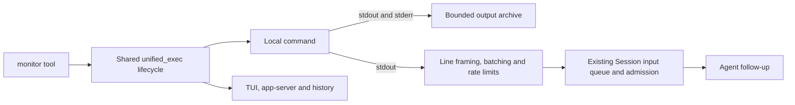

# Command Monitor — a Codex CLI fork

**Let local command output bring the agent back to work.**

[中文](README.zh-CN.md) · [Try the demo](docs/monitor-demo.md) · [Report your experience](https://github.com/chriswangcq/codex/issues) · [Implementation and validation](FORK_NOTES.md)

This independent community fork adds a `monitor` tool to Codex CLI. Start a local
command, let the conversation become idle, and let stdout lines
trigger follow-up work in the same conversation. The watched command chooses what
to emit; monitor does not semantically classify its output. When a turn is already running,
notifications join its existing input flow.

Use it with application logs, existing test watchers, and long-running local jobs.
The monitor runtime does not require the model to repeatedly ask for status.
Event handling still uses model calls; we have not measured a token-saving percentage.

## Preview status

- Based on **Codex CLI 0.169.0**, with the monitor migration at `443d3df224`.
- **Source preview for Apple Silicon macOS.** Other platforms have not been validated.
- The migration passed **2,825 Rust tests**, **9 Python contract tests**, schema
  generation, formatting and Clippy for 16 affected crates. This was a selected
  regression matrix, not the entire workspace. See [the evidence](FORK_NOTES.md#migration-validation).
- This source preview has no new prebuilt installer. Live-model end-to-end
  validation has not been performed for the 0.169.0 migration; the automated
  scenarios use model fixtures. The older 0.161.0 release is a different build.
- This is an independent fork, not an official OpenAI release. Model access and
  authentication use the underlying Codex configuration; no model service is included.

## What you can do

| Workflow | What the fork provides |
| --- | --- |
| Follow a local application log | Stdout lines can trigger contextual follow-up without another user prompt. |
| Use an existing test/build watcher | The watcher detects changes; monitor delivers its output to the agent. |
| Observe a long-running job | Receive bounded progress events and inspect the process from the CLI. |
| Manage active work | Use `/ps`, `/stop`, and the Down-arrow process manager to inspect or stop processes. |

Monitors reuse the existing command approval, sandbox and process lifecycle.
Stdout events are batched and rate-limited. Stderr is archived for inspection;
redirect `2>&1` explicitly if you want stderr to become live events too.
`task_stop` stops an individual monitor. `/stop` stops background terminals and monitors.

## Build and try this fork

The official npm package, Homebrew cask and OpenAI installer install upstream Codex,
not this fork. For this source preview, use the repository's package builder.

Prerequisites: Git, Python 3.11+, Rust via rustup, `just`, and the Xcode command-line
tools. The workspace selects its pinned Rust toolchain. The first build downloads
verified native dependencies and can take a while.

```sh
git clone --branch codex/monitor-preview https://github.com/chriswangcq/codex.git command-monitor
cd command-monitor
just assemble-codex-package \
  --target aarch64-apple-darwin \
  --cargo-profile dev-small \
  --package-dir "$PWD/dist/command-monitor"

./dist/command-monitor/bin/codex --version
./dist/command-monitor/bin/codex
```

Keep the complete package directory: the CLI needs its Code Mode host, executor,
resources and manifest. Run the explicit path above to select this build. The
binary version remains `0.169.0`; include `git rev-parse HEAD` in reports to identify
the fork revision. Build and packaging details are in the
[upstream package-builder guide](scripts/codex_package/README.md).

Then follow the [two-terminal demo](docs/monitor-demo.md): start a monitor, wait for
the conversation to become idle, append a log line, and observe the follow-up.

## How it fits together



The implementation separates output policy, archiving, worker coordination,
recovery and delivery. Unified exec owns process state; the existing Session owns
input admission. [Read the maintenance contract](FORK_NOTES.md).

## Boundaries

- `persistent: true` removes the normal timeout **within the current session**.
  Monitors do not survive closing or restarting the session.
- Monitor commands run locally with `tty: false`. Remote execution and native
  WebSocket monitoring are unsupported.
- Of command output, only stdout produces live events; stderr is archived.
  Lifecycle notifications can also trigger follow-up. Limits can truncate, suppress or stop noisy output;
  this is not an every-line delivery or complete-log retention guarantee.
- Notifications do not forcibly interrupt an in-flight model response or arbitrary
  tool execution. Delivery latency depends on the active turn.
- The app-server monitoring endpoints are experimental. This fork does not install
  or replace the official desktop app or IDE extension.

## Help validate the workflow

We are looking for a small first group of Apple Silicon users who regularly work
with local logs, watch-mode tests, or long jobs. [Open a feedback issue](https://github.com/chriswangcq/codex/issues)
with your command, platform, fork commit, expected follow-up and observed result.
Installation failures and noisy or missing notifications are especially useful.
Remove credentials and private log content before posting.

## License and upstream

[Apache-2.0](LICENSE). Existing OpenAI and third-party attributions are retained in
[NOTICE](NOTICE). This fork's changes and validation scope are documented in
[FORK_NOTES.md](FORK_NOTES.md). General upstream CLI documentation is available
from [OpenAI](https://developers.openai.com/codex/).
